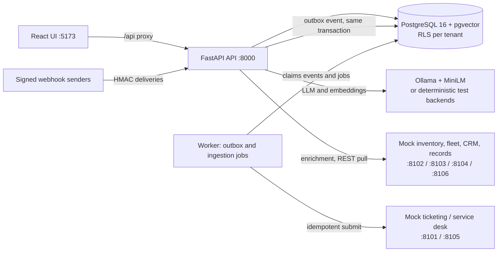
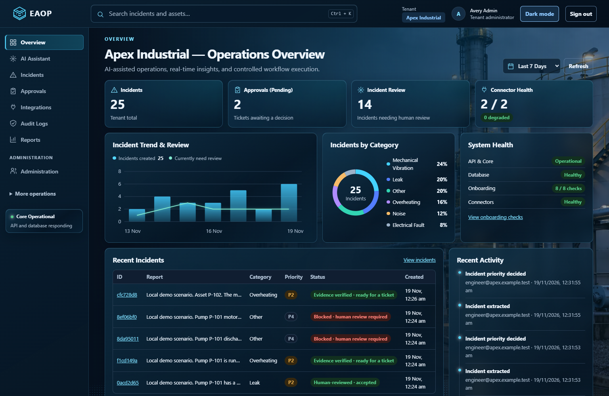
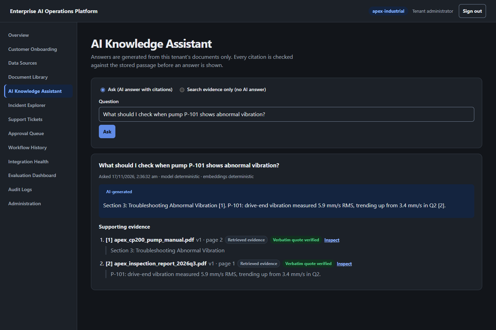
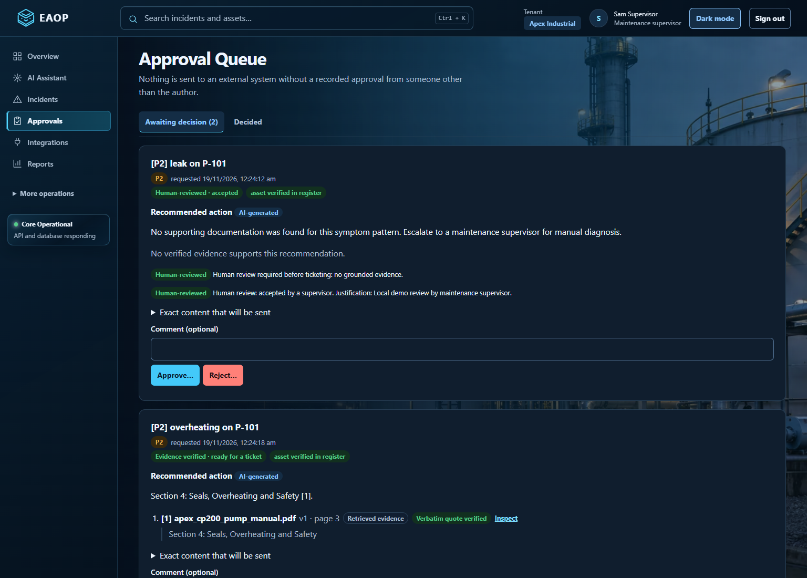
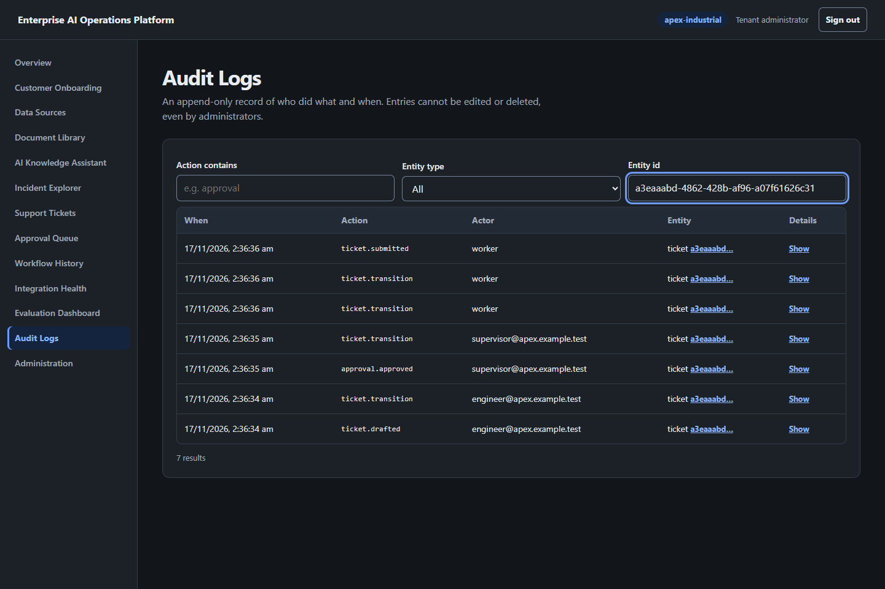
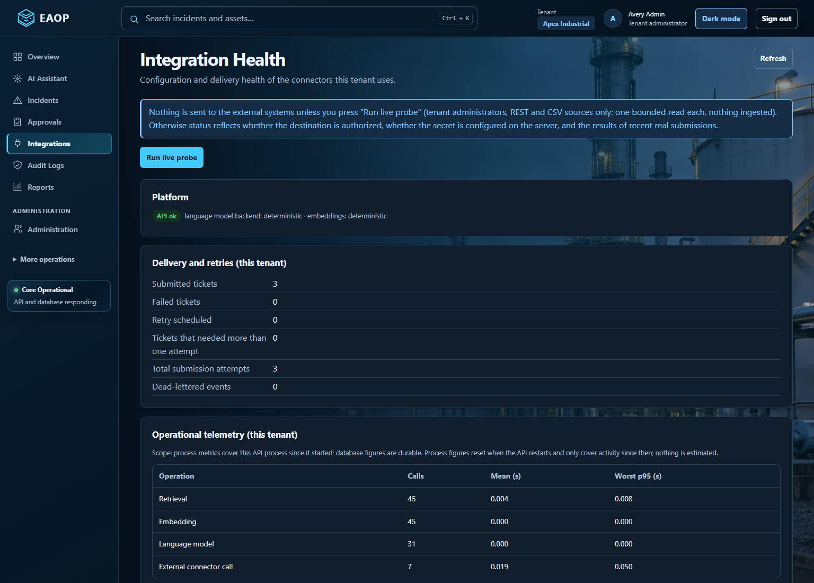
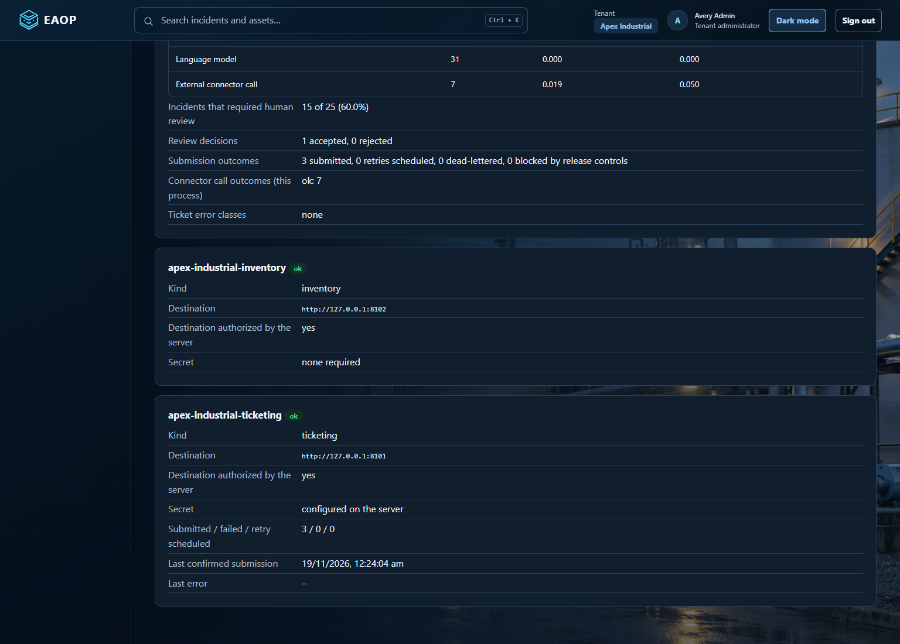

# Enterprise AI Operations Platform

A multi-tenant AI operations platform built as a Forward Deployed Engineering portfolio project. It helps maintenance and operations teams turn free-text fault reports into evidence-grounded incidents and approved support tickets, while keeping every customer's data isolated and every consequential action behind a human decision.

Both customers (Apex Industrial Manufacturing, Meridian Fleet Logistics) and all their data, people and systems are **fictional**. Everything runs locally on one Windows machine with free software and a CPU-only language model. The source is publicly viewable under a proprietary license. The application has no hosted deployment, release, or real customer usage.

> **Status, stated plainly.** A working local system with extensive automated tests: not a production system and **not a complete implementation of the V4.1 specification**. Of 238 requirements, 203 are assessed verified, 28 partial, 3 missing and 4 not evaluable ([reconciliation](docs/specification/v4.1-reconciliation-matrix.md), [closure plan, 79 unresolved at the tag; 35 remain](docs/planning/requirement-closure-plan.json), [final validation report](docs/planning/final-validation-report.md)). Several AI-quality targets are **not met** (section 20). All tests and evaluations were written by the same author; none is externally certified. The local tag `v4.1.0-local-rc1` marks an engineering checkpoint, not a release.

The sections below follow the order required by the specification (Part 29).

## 1. Project overview
One modular-monolith application serving two fictional customers through configuration only: document ingestion (PDF, CSV, JSON, text; REST pull, CSV and signed webhooks), hybrid retrieval with verified citations, structured incident extraction, deterministic priority rules, a nine-state ticket workflow with supervisor approval, a transactional outbox with an idempotent worker, an append-only audit log, and a 13-page React UI. Where each area stands (implemented, partial, simulated, planned) is in [docs/customer-delivery/technical-walkthrough.md](docs/customer-delivery/technical-walkthrough.md) and the requirement register above; nothing in this README overrides those records.

## 2. Business problem
- **Apex Industrial** (fictional pump and rotating-equipment plant): a technician reports "pump P-101 vibrates at 8.4 mm/s"; the team needs the right manual passage, the equipment's incident history, a correctly prioritised ticket in the maintenance system, and a supervisor's approval before anything is sent.
- **Meridian Fleet Logistics** (fictional truck fleet): the same workflow with different vocabulary (vehicles, brake pressure, coolant temperature), a different ticketing contract (work orders), and its own fleet, CRM and service-desk systems, added by configuration and public APIs only, with no customer-specific code. Discovery write-ups (fictional, labelled): [docs/customer-discovery](docs/customer-discovery/README.md).

## 3. Key capabilities
- Multi-tenant API (FastAPI, 55 operations), JWT auth, five roles, PostgreSQL row-level security, typed contracts and a standard error body.
- Durable ingestion jobs with bounded retry, retained originals and source-based reprocessing; REST pull (cursor, offset and page pagination, rate limiting, live probe), CSV and HMAC-signed webhooks with a durable replay ledger ([design](docs/architecture/webhooks-and-csv.md)).
- Hybrid retrieval, cited answers with verbatim-quote verification, insufficient-evidence refusal, prompt-injection quarantine.
- A numeric trust boundary: numbers from text or a model are unverified candidates and never drive priority (see section 11).
- Audited two-stage document deletion; human approval workflows; trace and correlation ids; fault injection and customer acceptance suites; a containerised stack; a one-command demonstration.

## 4. Architecture diagram
Diagrams of the actual data flows (ingestion, retrieval, incident to ticket, numeric trust, tenant isolation, observability): [docs/architecture/diagrams.md](docs/architecture/diagrams.md) and [system-architecture.md](docs/architecture/system-architecture.md).



## 5. Technology stack
Python 3.10+ (images use 3.12), FastAPI, Pydantic 2, SQLAlchemy, Alembic (migrations 0001 to 0017), PostgreSQL 16 with pgvector, Ollama running `qwen2.5:1.5b`, Sentence Transformers MiniLM embeddings, React 18 with Vite and TypeScript, a Python worker for background jobs, Docker Compose, and GitHub Actions for automated checks. Tests use Vitest, Playwright and pytest. Terraform examples are illustrative. Declared licences of everything installed: [THIRD_PARTY_NOTICES.md](THIRD_PARTY_NOTICES.md).

## 6. Customer scenarios
Step-by-step guides written against behaviour that was executed on the live stack (each states what is UI and what is API-only): [Apex Industrial](docs/customer-delivery/apex-demo-guide.md) and [Meridian Fleet](docs/customer-delivery/meridian-demo-guide.md). The 15 acceptance scenarios (UAT-A01..A08, UAT-B01..B07) are in `tests/acceptance/`.

## 7. Screenshots
### Product demo

The dark-mode walkthrough follows a fictional Apex Industrial maintenance request from a source-backed answer through supervisor review and confirmed delivery. These screenshots come from the live local application using deterministic AI backends and mock external systems.

**Tenant overview.** Baseline the incident review backlog, delivery outcomes, and approval turnaround before rolling out the workflow.



**Grounded maintenance answer.** The assistant retrieves tenant documents and shows the passages behind its answer to a pump vibration question.



**Supervisor approval.** A separate reviewer checks the asset and supporting evidence before approving or rejecting the outbound ticket.



**Ticket audit trail.** Filter the append-only log to trace who drafted, approved, and submitted a specific ticket.



**Integration health.** Check API health, submission attempts, scheduled retries, and dead-letter counts during rollout and support.



**Tenant connectors.** Review the configured Apex inventory and ticketing destinations, authorization status, and confirmed ticket delivery.



See the [guided walkthrough](docs/customer-delivery/technical-walkthrough.md) and [browser acceptance report](docs/planning/batch5-report.md) for the tested flows.

## 8. Local setup
Full runbook (startup order, health checks, failures, shutdown): [docs/operations/local-runbook.md](docs/operations/local-runbook.md). From the repository root (Windows paths shown):

```bash
cp .env.example .env                       # then set every placeholder value; never commit .env
python -m venv .venv
.venv/Scripts/python -m pip install -r backend/requirements-dev.txt
python scripts/dev.py up                   # PostgreSQL + pgvector in Docker
python scripts/dev.py migrate
python scripts/dev.py seed                 # Apex tenant, demo users, sample documents
python scripts/dev.py stack                # API :8000, worker, mocks :8101-:8106 (Ctrl-C stops all)
python scripts/dev.py onboard-meridian     # second customer, public API only (stack must be running)
cd frontend && npm install && npm run dev  # UI http://127.0.0.1:5173 ; API docs http://127.0.0.1:8000/docs
```
Requirements: Docker, Python 3.10+, Node 20+. Real local AI (optional): [docs/operations/real-ai-setup-windows.md](docs/operations/real-ai-setup-windows.md). The deterministic AI backends are test-only and are labelled as such in `/api/v1/health`. Containerised stack: `python scripts/container_smoke.py` ([deployment runbook](docs/operations/deployment-runbook.md)).

## 9. End-to-end demo
```bash
.venv/Scripts/python scripts/demo.py preflight   # checks prerequisites, changes nothing
.venv/Scripts/python scripts/demo.py up          # isolated database, migrations, Apex, services, Meridian, UI
.venv/Scripts/python scripts/demo.py down        # stops only what it started and drops only its own database
.venv/Scripts/python scripts/demo.py smoke --ingestion --rest --compare --backup   # automated end to end (about 2.5 minutes)
```
The shared `eaop` database is never touched. Evidence of executed runs: `evaluation/demo-runs/`. Reproducibility: **Gate A** (fresh application state) and **Gate B on the same machine** (clean checkout, clean Python and Node installs, exact lock file, isolated database and container stack: `python scripts/clean_environment_check.py --ollama`) have passed. The owner approved [Gate C technical acceptance with documented limitations](docs/planning/gate-c-owner-disposition.md). Complete demonstration reproducibility remains open: the retained evidence does not yet establish the Apex connector configuration walkthrough and a useful cited maintenance answer under the documented reviewer procedure. Reviewer handover: [docs/customer-delivery/demo-handover.md](docs/customer-delivery/demo-handover.md). The 27 demonstration steps required by the specification, mapped to commands and evidence: [docs/customer-delivery/demonstration-27-steps.md](docs/customer-delivery/demonstration-27-steps.md).

## 10. API documentation
Interactive OpenAPI at `http://127.0.0.1:8000/docs` when the stack runs. Typed success and error schemas cover all 55 operations and are verified against runtime responses: [docs/api/api-quality.md](docs/api/api-quality.md), [response inventory](docs/api/response-inventory.md), integration contracts in [docs/customer-delivery/04-integration-specification.md](docs/customer-delivery/04-integration-specification.md).

## 11. Security model
- Every tenant-owned table is under PostgreSQL row-level security; the API and worker connect as non-superuser roles without `BYPASSRLS`. The tenant context is set per transaction so it cannot leak through the connection pool. The current database role, not the token claim, decides permissions.
- Roles: platform administrator, tenant administrator, maintenance supervisor, support engineer, read-only auditor. Requests to another tenant's resources return 404. Authors cannot approve their own tickets.
- Connector destinations are controlled by the server through an egress allow-list (no redirects, pinned addresses); secrets are referenced by environment-variable name and never stored or returned. Webhooks use HMAC-SHA256 over timestamp, delivery id and raw body with constant-time comparison and a replay ledger.
- The audit log is append-only (database trigger). Limits and login throttling are per process (not a distributed limiter).
- **Numeric trust boundary.** A number found in free text or proposed by the model is an **UNVERIFIED candidate** and **never drives automatic priority**. A number is eligible only as a typed observation from an authenticated submitter that an authorised reviewer who is not the creator has verified, or as an HMAC-signed simulation fixture labelled SIMULATED. Requirement V41-14.02 stays **partial**: the frozen acceptance runs failed and the last one failed only a provenance count (63 of 64) ([architecture](docs/evaluation/numeric-safety-architecture-v8.md), [provenance closure](docs/evaluation/numeric-safety-provenance-closure-v8.md)).
- Document deletion is audited and two-stage with a tombstone ([design](docs/architecture/document-lifecycle.md)); it does not erase text already copied to tickets, external systems or backups.
- Details and tests: [docs/security/phase4-security-and-reliability.md](docs/security/phase4-security-and-reliability.md), [SECURITY.md](SECURITY.md).

## 12. Customer acceptance results
UAT-A01..A08 and UAT-B01..B07: 15 of 15 passed in deterministic and in real-AI mode ([deterministic](evaluation/customer-acceptance/deterministic/uat-report.md), [real AI](evaluation/customer-acceptance/real/uat-report.md)). The live demonstration checkpoint covering both customers, ingestion, REST, CSV and webhook integrations passed on the final run ([run](evaluation/demo-runs/20261113-152713-c19b/)).

## 13. Fault-injection results
Fault injection FI-01..FI-10 and REL-01..REL-04: 15 of 15 scenarios passed ([report](evaluation/failure-reports/phase7/fi-report.md)). All faults are simulated against mock systems. REL-01 (an intermittent start-up stall observed once) remains **open** ([register](docs/planning/reliability-defect-register.md)).

## 14. Verified engineering benchmarks
See **Verified Engineering Results** below. The corpus is small and synthetic, labels are author-written, and intervals are wide; method and limits: [docs/evaluation/phase8-evaluation-protocol-v1.1.md](docs/evaluation/phase8-evaluation-protocol-v1.1.md); measured latencies and rates: [docs/performance/measured-performance.md](docs/performance/measured-performance.md).

### Verified Engineering Results
Every value below is copied from the cited artifact and checked against it by `tests/test_readme_results.py`. Unexecuted measurements are shown as "not measured", never estimated.

| Metric | Actual result | Target | Test command | Evidence location |
|---|---|---|---|---|
| Requirements assessed verified (of 238) | 203 verified, 28 partial, 3 missing, 4 not evaluable | all verified for full acceptance | `python scripts/generate_v41_reconciliation.py` | `docs/specification/v4.1-requirements.json` |
| Fault-injection and reliability scenarios | 15 of 15 passed | all pass | `python -m pytest tests/fault_injection -q` | `evaluation/failure-reports/phase7/fi-report.json` |
| Customer acceptance scenarios (deterministic backends) | 15 of 15 passed | all pass | `python -m pytest tests/acceptance -q` | `evaluation/customer-acceptance/deterministic/uat-report.json` |
| API-quality properties | 9 of 9 verified | all verified | `python scripts/api_quality_report.py` | `evaluation/api-quality/api-quality-evidence.json` |
| Citation correctness, Phase 8 baseline (held-out) | 95.1% (point estimate; interval overlaps the target) | at least 95% | commands recorded in the report (long, needs Ollama; the held-out split is consumed and must not be re-tuned against) | `docs/evaluation/phase8-heldout-report.md` |
| Citation correctness, Phase 8 candidate (held-out) | 89.8% | at least 95% | as above | `docs/evaluation/phase8-heldout-report.md` |
| Grounded-answer coverage, candidate (held-out) | 59.3% | no target in the original specification | as above | `docs/evaluation/phase8-heldout-report.md` |
| Raw structured-output validity, candidate (held-out) | 18 of 20 (90%) | 100% | as above | `docs/evaluation/phase8-heldout-report.md` |
| Backend tests | 850 passed, 18 skipped (opt-in real-AI), 0 failed at the historical baseline (commit dfbd8ec), before the evaluation registry API and verifier changes | all pass | `python -m pytest backend/tests -q` | not archived as a file; rerun the command |
| Transient-failure recovery rate (defined 11-case suite, mock ticketing, deterministic AI backends) | 11 of 11 recovered (100%); coarse, same-author, mock external system | at least 95% | `RECOVERY_REPORT=1 python -m pytest tests/fault_injection/test_recovery_rate.py -q` | `evaluation/recovery/recovery-rate-report.json` |
| Integration success rate (defined 14-run suite: REST, CSV, signed webhooks; local mock sources, deterministic AI backends) | 14 of 14 succeeded (100%); coarse, same-author | at least 95% (own threshold: the specification names none for this metric) | `INTEGRATION_REPORT=1 python -m pytest backend/tests/test_integration_success_rate.py -q` | `evaluation/integration/integration-success-rate-report.json` |
| Manual versus automated comparison | automated system time only; no observed human data | observed data needed | `python scripts/demo.py smoke --compare --no-browser` | `evaluation/comparison/protocol.md` |

## 15. Hardware specifications
Intel Core i7-1165G7 (4 cores, 8 threads), 15.7 GB RAM, Intel Iris Xe graphics (no CUDA, so CPU-only inference), Windows 11, about 120 GB free disk at the start. Captured by `python scripts/capture_hardware.py`; electricity, storage and bandwidth notes: [docs/operations/resource-requirements.md](docs/operations/resource-requirements.md).

## 16. Test commands
```bash
python -m pytest backend/tests -q   # backend (needs PostgreSQL running; uses its own eaop_test database and deterministic backends)
python -m pytest tests -q           # root suites: acceptance, traceability, consistency (fault injection is opt-in)
cd frontend && npm run typecheck && npm run lint && npm test          # unit tests
cd frontend && npx playwright test                                      # browser tests (isolated stack)
RUN_REAL_AI=1 python -m pytest backend/tests/test_real_ai.py -q         # opt-in, needs Ollama
python scripts/secret_scan.py       # must report 0 findings
```
Which suites run where: [docs/operations/ci-and-local-tests.md](docs/operations/ci-and-local-tests.md).

## 17. CI status
All six GitHub Actions jobs passed on the private engineering source commit `b021d83e2fe7d1726974851422ce0bfa629655e1` (run `44015065897`). This portfolio snapshot starts with independent Git history and its own [CI workflow](.github/workflows/ci.yml). The engineering result records what passed on the source commit. Portfolio CI results are tracked separately.

## 18. Cloud portability
Analysis and illustrative Terraform for AWS, with Azure and Google Cloud comparisons: [docs/architecture/cloud-portability.md](docs/architecture/cloud-portability.md), [infrastructure/terraform](infrastructure/terraform/README.md). Terraform passed formatting and local schema validation against AWS provider 5.100.0. No cloud resources were provisioned. [Validation evidence](evaluation/terraform/provider-validation.md).

## 19. Architecture tradeoffs
[docs/architecture/deployment-tradeoffs.md](docs/architecture/deployment-tradeoffs.md), [the tradeoff record](docs/customer-delivery/09-architecture-tradeoff-record.md), [entity-model decision](docs/architecture/entity-model-decision.md), [optional infrastructure decision](docs/architecture/optional-infrastructure-decision.md).

## 20. Known limitations
- The 95% citation-correctness target and the 100% raw schema-validity target are **not met** on the held-out split; a 1.5B CPU model withholds or refuses part of the answerable questions and sometimes picks a near-miss category. About three in four extracted incidents stop for human review.
- V41-14.02 is partial. Distributed rate limiting is not implemented (limits are per process). No OpenTelemetry SDK, Prometheus or Grafana (trace ids and structured logs exist).
- Document deletion has no UI control; backups keep deleted content; originals of exhausted jobs never expire.
- Containers use deterministic AI backends; Ollama inside a container is untested. No independent reviewer has reproduced the demonstration.
- Handlers return dictionaries validated at the framework boundary; accessibility was audited only with automated axe in one browser.
- **Engineering history:** PROV-01 records 55 historical provenance exceptions in the private engineering repository. The portfolio snapshot imports no engineering commits.
- Reproduction passed from a clean checkout with clean installs on the **same machine** only ([evidence](evaluation/clean-environment/20261113-183717/report.md)); no fresh machine and no independent reviewer.
- Customers, data, sensors and external systems are fictional or mocked.

## 21. License information
Proprietary Source-Visible License. See [LICENSE](LICENSE). Not open source. The license has not been legally reviewed. Third-party notices: [THIRD_PARTY_NOTICES.md](THIRD_PARTY_NOTICES.md) (declared licences read from installed metadata; not a legal review). Security policy: [SECURITY.md](SECURITY.md).
