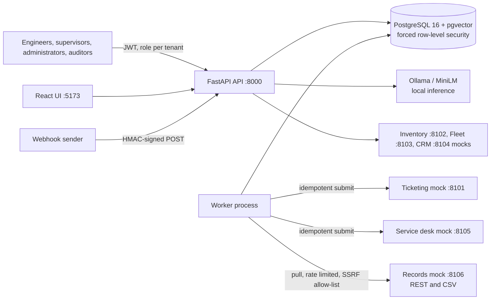
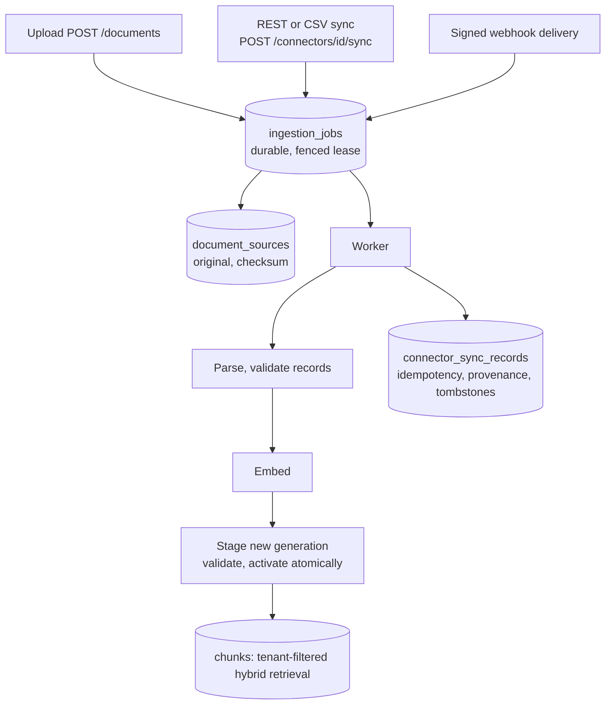
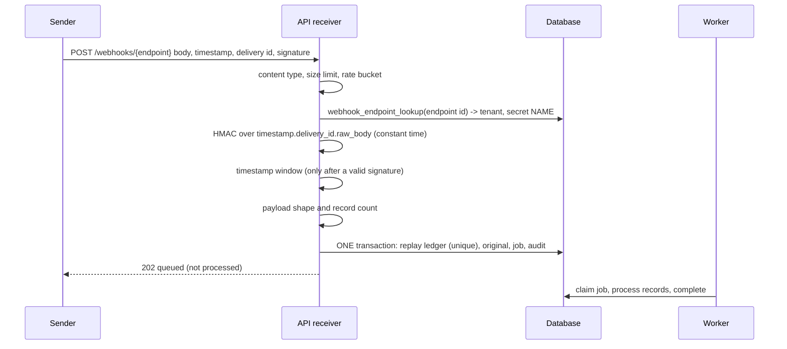
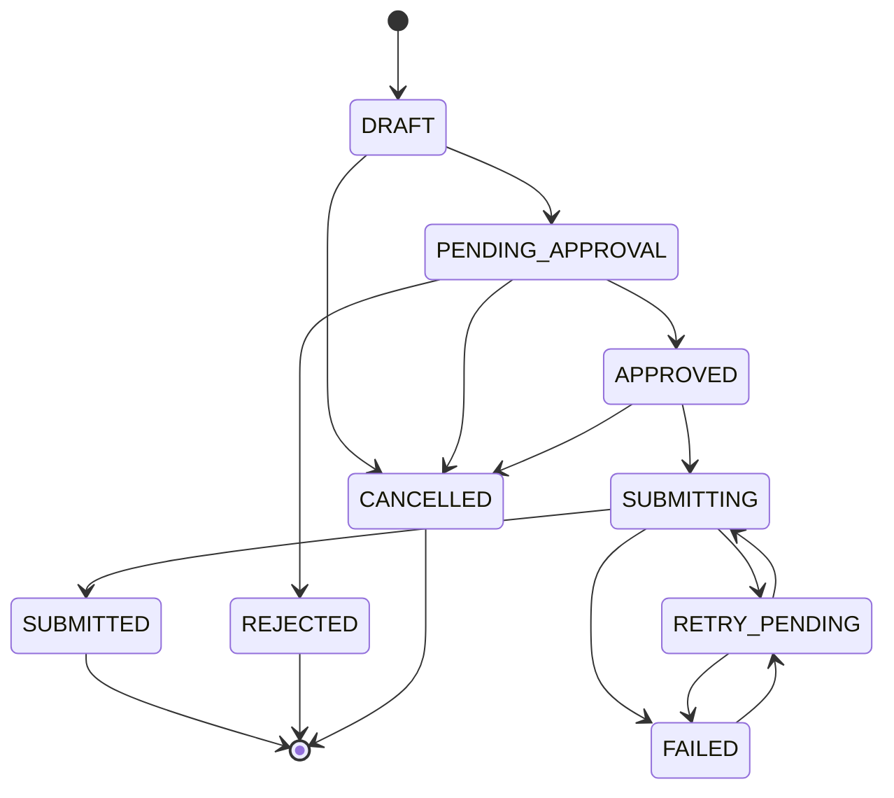
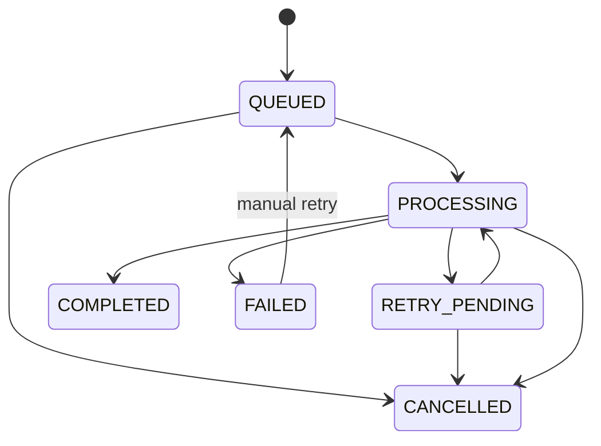
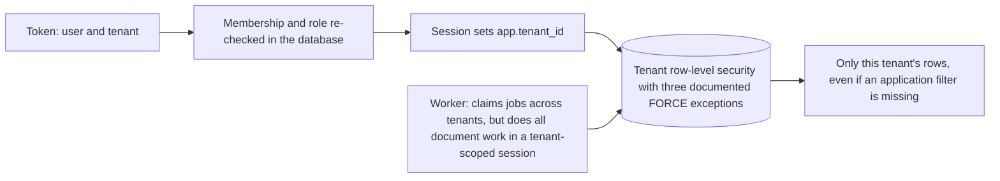

# Architecture diagrams

Mermaid diagrams of the system as built (renders on GitHub and in most Markdown viewers). They describe the local platform; no cloud deployment exists. States and names are taken from the code (`app/workflows/state_machine.py`, `app/ingestion/jobs.py`, `app/ingestion/webhooks.py`).

## 1. System context

## 2. Ingestion paths, one pipeline

## 3. Webhook delivery (order of checks)

## 4. Ticket workflow state machine

Submission is allowed only from APPROVED, RETRY_PENDING or SUBMITTING and the approval is re-verified from the approvals table, so a state value alone never authorises an external call.

## 5. Ingestion job states

## 6. Tenant isolation

