# System architecture (as implemented)

Diagrams are Mermaid sources and show only what exists in this repository. Cloud infrastructure, application containers, OpenTelemetry and distributed rate limiting are **not** implemented and are not drawn. Sources used: `backend/app/main.py`, `backend/app/api/v1/*`, `backend/app/workflows/*`, `backend/app/ai/*`, `backend/app/ingestion/*`, `backend/app/retrieval/*`, `workers/run_worker.py`, `scripts/dev.py`, and the earlier phase documents ([Apex slice](phase2-apex-slice.md), [Meridian](phase5-meridian.md)).

## 1. Components and ports (local)

```mermaid
flowchart TB
  subgraph Browser
    UI[React + Vite UI\n127.0.0.1:5173]
  end
  subgraph Backend process
    API[FastAPI API :8000\n55 operations under /api/v1]
    MW[Middleware: body-size limit, CORS,\ncorrelation id, error handlers]
    RBAC[JWT + role check\nper route]
    LIM[Bounded concurrency\ningestion 2, inference 2]
  end
  subgraph Worker process
    W[Outbox worker\nworkers/run_worker.py]
  end
  subgraph PostgreSQL 16 + pgvector (Docker, 127.0.0.1:5432)
    DB[(tenant tables under RLS,\nappend-only audit log,\noutbox_events, embeddings)]
  end
  subgraph Local AI
    LLM[Ollama qwen2.5:1.5b :11434\nor deterministic test backend]
    EMB[MiniLM embeddings\nor deterministic test embedder]
  end
  subgraph Mock customer systems
    T[Ticketing :8101]
    I[Inventory :8102]
    F[Fleet telematics :8103]
    C[CRM :8104]
    S[Service desk :8105]
  end
  UI -->|/api proxy| MW --> RBAC --> API
  API --- LIM
  API -->|app role, RLS| DB
  W -->|worker role, RLS| DB
  API --> LLM
  API --> EMB
  API -->|enrichment lookups| I
  API -->|enrichment lookups| F
  API -->|enrichment lookups| C
  W -->|idempotent create ticket / work order| T
  W -->|idempotent create ticket / work order| S
```

Roles and processes are started by `python scripts/dev.py stack` (API, worker and five mocks); PostgreSQL by `python scripts/dev.py up`; the UI by `npm run dev`. Docker Compose defines only PostgreSQL.

## 2. Authentication, RBAC and tenant isolation

```mermaid
sequenceDiagram
  participant U as Client
  participant A as API
  participant D as PostgreSQL (app role)
  U->>A: POST /auth/login {email, password, tenant}
  A->>D: verify credentials, membership (login throttle per process)
  A-->>U: JWT (HS256, expiry) with tenant and role claims
  U->>A: request + Bearer token
  A->>D: BEGIN; set_config('app.tenant_id', ..., local) ; set_config('app.user_id', ...)
  A->>D: current database role decides permission (rbac.py map)
  A->>D: query (RLS filters every tenant table)
  D-->>A: only this tenant's rows
  A-->>U: 200, or 403 insufficient_role, or 404 for another tenant's id
  Note over A,D: COMMIT/ROLLBACK discards the tenant setting, so it cannot leak through the connection pool
```

Roles: platform administrator (creates tenants and members; no tenant data pages), tenant administrator, maintenance supervisor, support engineer, read-only auditor. Permissions are the map in `backend/app/core/rbac.py`; the UI only hides what the API would refuse.

## 3. Document ingestion and retrieval

```mermaid
flowchart LR
  UP[POST /documents\nmultipart] --> CHK[size limit, filename sanitising,\nextension allow-list]
  CHK --> PARSE[parse PDF / CSV / JSON / TXT / MD\npage or record provenance]
  PARSE --> HASH[SHA-256; duplicate detection;\nversioning]
  HASH --> CH[chunking]
  CH --> EMB[embeddings]
  EMB --> STORE[(chunks + vectors\ntenant-scoped, RLS)]
  Q[POST /search, /ai/ask,\n/incidents/extract] --> HYB[hybrid search:\npgvector cosine + full-text,\nreciprocal rank fusion,\ntenant filter first]
  STORE --> HYB
  HYB --> QUAR[prompt-injection heuristics:\nsuspicious passages quarantined]
  QUAR --> CTX[context assembly]
  CTX --> LLM[local LLM]
  LLM --> VER[citation verification:\npassage retrieved? quote verbatim?]
  VER -->|verified| ANS[grounded answer + citations]
  VER -->|otherwise| WITH[answer withheld /\ninsufficient evidence]
```



Deleted documents are excluded at every one of these boundaries (see [document lifecycle](document-lifecycle.md)). A tenant indexed with one embedding backend is refused by the other (HTTP 409 `embedding_model_mismatch`) until reindexed with `scripts/reindex_embeddings.py`.

## 4. Incident extraction to approved ticket (implemented flow)

```mermaid
flowchart TB
  R[Free-text report\n+ optional structured observations] --> X[POST /incidents/extract]
  X --> AS[asset lookup in the tenant register]
  X --> RET[retrieval: manual passages,\nrelated past incidents]
  X --> NUM[numeric evidence handling (section 5)]
  X --> RULES[deterministic priority rules\n(never the model)]
  AS --> INC[incident validated by Pydantic schema]
  RET --> INC
  NUM --> INC
  RULES --> INC
  INC -->|verified evidence and registered asset| PR[review_status pending_review]
  INC -->|otherwise| NR[review_status needs_review: blocked]
  NR -->|supervisor/admin accept| PR
  NR -->|reject| REJ[rejected: never a ticket]
  PR --> TK[POST /tickets: DRAFT]
  TK --> RA[request approval: PENDING_APPROVAL]
  RA -->|supervisor/admin other than author| AP[APPROVED]
  RA -->|reject| RJ[REJECTED]
  AP -->|same transaction| OB[(outbox event + approval row + audit event)]
  OB --> WK[worker claims with FOR UPDATE SKIP LOCKED + lease]
  WK --> RV[re-verify approval record]
  RV --> SB[submit with Idempotency-Key]
  SB -->|ok| OK[SUBMITTED + external id]
  SB -->|transient| RP[RETRY_PENDING, exponential backoff]
  RP --> SB
  SB -->|permanent / exhausted| FL[FAILED; supervisor may retry]
```

Observed on 2026-11-13 against the local stack: Apex ticket reached `SUBMITTED` with external id `MNT-1001`, Meridian with `WO-7001` (see the demo guides).

## 5. Numeric evidence trust boundary

```mermaid
flowchart LR
  FT[number in free text\nor proposed by the model] --> A[class A: UNVERIFIED candidate\nnot eligible for priority\nflagged for urgent review]
  OBS[structured observation from\nauthenticated submitter] --> C[class C: VALIDATED, submitted\nnot yet eligible]
  SIM[HMAC-signed simulation fixture] --> F[class F: SIMULATED, labelled\neligible]
  A --> HV
  C --> HV[POST /incidents/{id}/measurements/{name}/verify\nreviewer role, not the creator,\nexpected_trust_status guard]
  HV -->|approve| D[class D: HUMAN_VERIFIED\neligible for priority]
  HV -->|reject| REJ2[rejected, stays ineligible]
  D --> PRI[deterministic priority rules re-run]
  F --> PRI
```

Implemented in `backend/app/ai/measurement_trust.py`, `measurement_evidence.py` and `services/incident_service.py`. The Incident Explorer (frontend `MeasurementPanel` and `ObservationForm`, Batch 5) shows each measurement with its trust class and source, lets an engineer submit structured observations while analysing a report, and lets a supervisor or administrator who did not create the incident verify or reject a candidate. The UI never sets a trust status and shows the priority the server returns. Requirement V41-14.02 stays partial ([record](../evaluation/numeric-safety-provenance-closure-v8.md)).

## 6. Audit logging and observability

```mermaid
flowchart LR
  ACT[every state change, review, approval,\nconnector call, member change] --> AUD[(audit_events\nappend-only trigger)]
  REQ[every request] --> LOG[JSON log line:\ncorrelation id, route template, status, duration]
  REQ --> MET[in-process counters and timers\nlabelled by tenant id]
  AUD --> API2[GET /audit (admin, auditor)]
  MET --> OBS[GET /observability/summary\n+ durable database counts]
  DB2[(outbox, tickets, approvals)] --> OBS
  OBS --> UI2[Integration Health page]
```

Limits: no trace ids; process metrics reset on restart and do not cover the worker; no OpenTelemetry or Prometheus ([observability](../operations/observability.md)).

## 7. Data model summary
Tenants, users and memberships; documents, document versions, chunks (with a generation) and embeddings, and durable ingestion jobs (with an `embedding_profiles` row per tenant); incidents (with measurement records); tickets, approvals and outbox events (the Workflow History page reads outbox and ticket history); connectors; tenant domain profiles (versioned); audit events. Migrations `0001` to `0017` (0009 adds the document lifecycle, see [document-lifecycle.md](document-lifecycle.md); 0010 adds durable ingestion jobs and chunk generations, see [ingestion-jobs.md](ingestion-jobs.md); 0011 adds retained original files in `document_sources`; 0012 adds REST pull synchronisation, see [rest-ingestion.md](rest-ingestion.md); 0013 adds signed webhooks and CSV provenance, see [webhooks-and-csv.md](webhooks-and-csv.md); 0014 adds the evaluation runs registry, see [entity-model-decision.md](entity-model-decision.md); 0015 adds shared rate-limit state and durable metric series, see [rate-limiting-limitations.md](../security/rate-limiting-limitations.md) and [observability.md](../operations/observability.md)) (`backend/migrations/versions`). `tenants` and `users` are not under RLS (access is controlled in application code); `memberships` is.
